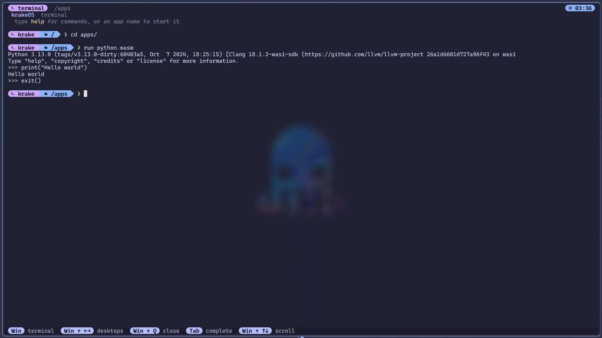
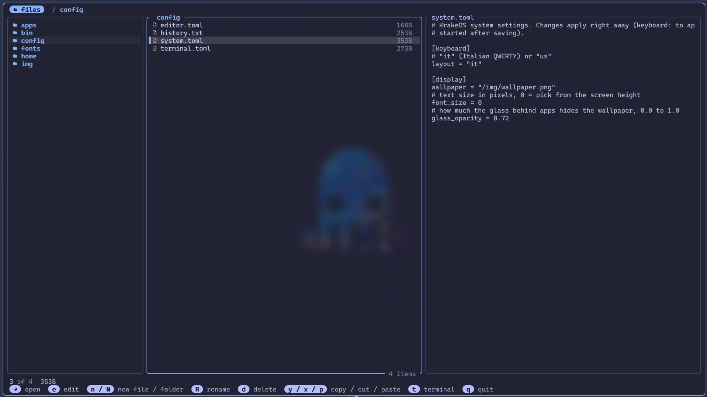

  

<h1 align="center">KrakeOS</h1>

  A RISC-V operating system written from scratch in Rust. 
  Multi-core kernel, its own file system, an ahead-of-time WebAssembly compiler, 
  and a keyboard-driven desktop that runs a terminal, a file manager, an editor and Python 3.13.

  
  

## Highlights

**Kernel**
- Boots on QEMU virt through OpenSBI, parses the device tree, and runs with Sv39 paging.
- Symmetric multiprocessing: secondary harts start through SBI HSM, page table changes are flushed on every hart through SBI RFENCE, and a re-entrant ticket lock guards the kernel.
- Preemptive round-robin scheduler shared by all harts, with sleeping, waiting and per-hart idle loops.
- Lazy FPU switching: floating point state is only saved and loaded for threads that use it.
- System calls for files, memory, threads, devices and pipes, plus per-app memory reservations that are released when an app exits.

**Drivers**
- VirtIO block, GPU, keyboard and tablet, a Goldfish real-time clock and the 16550 UART.

**File system**
- FatSquid, a custom file system with directories, rename, delete and truncation.
- fatsquid_fmt, a host tool that formats, packs and extracts disk images, so settings and user files survive a rebuild.

**WebAssembly runtime**
- Every app is a WebAssembly module. wasm_runner loads it in user mode.
- wasmaot compiles modules ahead of time straight to native RISC-V code, with wasmi as an interpreter fallback.
- A WASI preview 1 layer covers files, directories, clocks, randomness, arguments, environment and stdio, which is enough to run the official CPython 3.13 build unmodified.

**Desktop**
- A compositor with one full-screen desktop per app, a wallpaper and a translucent glass layer, redrawing only damaged regions.
- inkui, a terminal-style UI toolkit with TrueType text rendering (Cascadia Code Nerd Font), widgets, a shared clipboard and TOML settings.
- Italian and US keyboard layouts, chosen in /config/system.toml.

## Apps

| App | What it does |
| --- | --- |
| terminal | Shell with history, tab completion and file commands (ls, cd, cat, cp, mv, rm, mkdir, ps, kill, fetch) |
| python | CPython 3.13, running inside the terminal: an interactive prompt or a script |
| files | Three-pane file manager with preview, rename, delete, copy, cut and paste |
| editor | Text editor with syntax highlighting, clipboard and settings checks on save |
| viewer | Image viewer |
| calc | Calculator with history |

## Building and running

Requirements: Rust 1.88 or newer with the riscv64gc-unknown-none-elf and wasm32-wasip1 targets, and QEMU with qemu-system-riscv64.

    rustup target add riscv64gc-unknown-none-elf wasm32-wasip1

On Windows, run.bat builds everything, packs the disk image and starts QEMU with 4 cores:

    run.bat

It keeps the settings and files saved inside the OS across rebuilds.

On Linux, macOS or anywhere else, the Dockerfile builds everything, so only Docker and QEMU are needed. It writes the kernel and a fresh disk image to the out folder:

    docker build --output out .

Then boot it:

    qemu-system-riscv64 -machine virt -bios default -smp 4 -m 512M \
      -drive file=out/fs.img,format=raw,if=none,id=hd0 -device virtio-blk-device,drive=hd0 \
      -device virtio-gpu-device -device virtio-keyboard-device -device virtio-tablet-device \
      -serial stdio -kernel out/kernel

Each Docker build starts from the files in disk, so anything saved inside the OS lives in out/fs.img until the next build.

## Usage

| Keys | Action |
| --- | --- |
| Win or Right Ctrl | Open a terminal |
| Win + Left / Right | Switch desktops |
| Win + Up / Down | Scroll |
| Win + Q | Ask the app to quit (twice to force it) |
| Ctrl + C / X / V | Copy, cut and paste through the shared clipboard |

Right Ctrl works as Win, for remote desktop clients that keep the Win key for the host.

Type python in the terminal for a Python prompt, or python /home/script.py to run a script. Ctrl + D leaves Python and Ctrl + C stops it. The standard library ships as a single precompiled zip in /apps/lib.

Settings live in /config as TOML files (system, terminal, editor). Type config in the terminal to edit them; display changes apply immediately.

## License

The code is under the APACHE 2.0 license while the bundled Cascadia Code Nerd Font is licensed under the SIL Open Font License (LICENSE-SIL-OFL).
